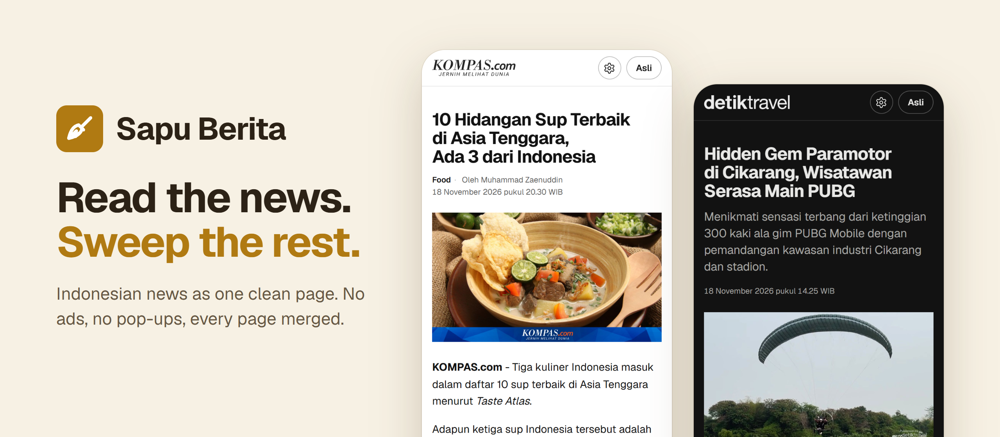
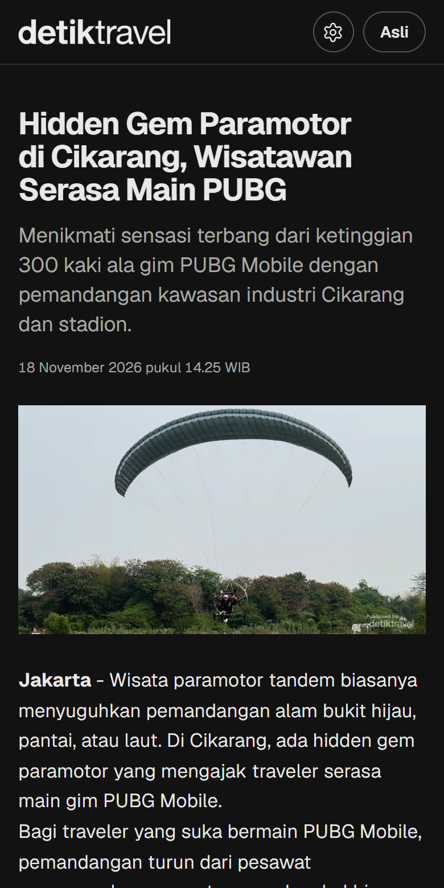
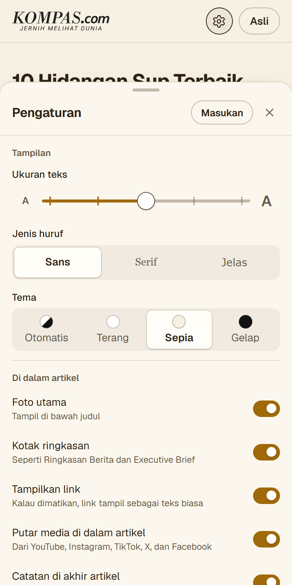
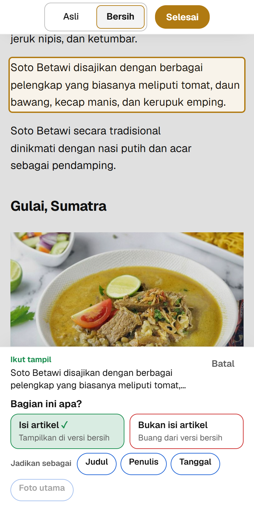

<picture>
  <source media="(prefers-color-scheme: dark)" srcset="docs/img/banner-dark.png">
  
</picture>

  

   

### [Install page](https://dhantyo.github.io/sapu-berita/) · [Chrome](https://chromewebstore.google.com/detail/cnpcdeijcckcobfngmglmdfgfcdlnglc) · [Edge](https://microsoftedge.microsoft.com/addons/detail/bhdciokajcobbbajokfomgjoonofcdbj) · [Android](docs/install-android.md) · [iPhone, iPad, Mac](docs/install-apple.md)

> [!NOTE]
> **Beta.** Sapu Berita is still early (0.x). If an article looks wrong, [report it](../../issues/new/choose) with the link.

## What it does

<table>
<tr>
<td width="50%" valign="top">

🧹 **Removes the clutter** Ads, "Baca Juga" (read also) link lists, share buttons, Google News and newsletter prompts.

</td>
<td width="50%" valign="top">

📄 **Merges pages** Articles split over 2, 3 or 5 pages appear whole, on one page.

</td>
</tr>
<tr>
<td valign="top">

📝 **Tidies summaries** Editor summary boxes ("Ringkasan Berita", key points) become one clean list.

</td>
<td valign="top">

🖼️ **Keeps what matters** Photos, captions, and social media posts that are part of the story.

</td>
</tr>
<tr>
<td valign="top">

🏷️ **Shows the outlet's logo** Taken from the site itself, so you always know who you're reading.

</td>
<td valign="top">

🎨 **Your way** Text size, font (serif, sans, extra-legible), light, sepia or dark theme, Indonesian or English interface.

</td>
</tr>
</table>

The **Asli** (Original) button always takes you back to the publisher's page.

&nbsp;
&nbsp;
&nbsp;

## Install

| Device | How it works | Get it |
|---|---|---|
| 💻 **Computer** Chrome, Brave, Opera, Vivaldi, Edge | An extension that runs automatically on every supported article and updates itself. | [Chrome](https://chromewebstore.google.com/detail/cnpcdeijcckcobfngmglmdfgfcdlnglc) [Edge](https://microsoftedge.microsoft.com/addons/detail/bhdciokajcobbbajokfomgjoonofcdbj) |
| 🤖 **Android** | The same extension, in Edge (or Firefox, once Mozilla approves it). Chrome for Android doesn't allow extensions; there you can use a bookmark instead. | [Android guide](docs/install-android.md) |
| 📱 **iPhone, iPad** | A Safari bookmark today, an Apple Shortcut (Share → Sapu Berita) soon. Always the latest version. | [Apple guide](docs/install-apple.md) |
| 🍎 **Mac with Safari** | One button in Safari's Favourites bar. Always the latest version. | [Apple guide](docs/install-apple.md) |

Not sure? The [install page](https://dhantyo.github.io/sapu-berita/) picks the right steps for your device and browser.

## Supported sites

**29 outlets**, including regional editions:

> Detik · Kompas · Tribunnews · CNN Indonesia · CNBC Indonesia · Liputan6 · Merdeka · Suara · Okezone · Viva · iNews · JPNN · ANTARA · Republika · Bisnis.com · Tirto · Tribrata News · Kumparan · IDN Times · Sindonews · Jawa Pos · Pikiran Rakyat · Kontan · Katadata · Media Indonesia · Berita Satu · Medcom · Kompas TV · DW Indonesia

**Not yet:** Tempo (paywalled; Sapu Berita doesn't bypass paywalls). Want another site? [Suggest it](../../issues/new/choose).

## Updates

- **Site fixes** (when a news site changes its layout) arrive automatically, without updating the app.
- **Extension from a store:** nothing to do; the store updates it.
- **iPhone, iPad, Mac:** nothing to do. The Shortcut and the bookmark always run the newest version.

## Privacy

> [!TIP]
> **Everything runs on your device.** No server, no analytics, no account. Sapu Berita doesn't know what you read.

Articles still load from the publisher's own site, so your visit counts for them as usual.

Once a day it downloads two small files from GitHub: the latest version number and the latest site rules. Nothing about you or your reading is sent. You can turn it off under **the gear button → Cek update** (check for updates). Feedback is only sent when you send it yourself, and changes from **Atur isi artikel** (adjust the article) only if you agree the first time it asks; both go to a Google Form. Details: [privacy page](https://dhantyo.github.io/sapu-berita/privacy.html).

## Made with AI

Sapu Berita is built with AI. Nearly all of its code, documentation and design were written by Claude, Anthropic's AI model, working under the direction of the maintainer, who decides what gets built, tests it and publishes each release. Site rules are checked against real articles by automated tests and a daily live check. If something looks wrong, please [report it](../../issues/new/choose).

## Contributing

News sites change their layouts often, so the per-site rules need care. Reporting a broken article already helps a lot: open **the gear button → Beri masukan** (give feedback) on that article. To work on code or rules, see [CONTRIBUTING.md](CONTRIBUTING.md) and [docs/DEVELOPING.md](docs/DEVELOPING.md).

## Thank you

Sapu Berita stands on the work of people who shared theirs. Thank you to everyone behind these projects.

**In the reader**

| Project | What it does here | License |
|---|---|---|
| [Readability](https://github.com/mozilla/readability) by Mozilla | Finds the article body on pages without a site rule. It also powers Firefox's reader view. | Apache&#8209;2.0 |
| [DOMPurify](https://github.com/cure53/DOMPurify) by Cure53 | Makes the article's HTML safe before it is shown. | MPL&#8209;2.0 / Apache&#8209;2.0 |
| [PhotoSwipe](https://github.com/dimsemenov/photoswipe) by Dmytro Semenov | The full-screen photo viewer: swipe, pinch and double-tap zoom. | MIT |

**Filter lists and site knowledge**

| Project | What it does here | License |
|---|---|---|
| [AdBlockID](https://github.com/realodix/AdBlockID) | Ad, video and annoyance selectors for Indonesian sites. | GPL&#8209;3.0 |
| [ABPindo](https://github.com/ABPindo/indonesianadblockrules) | Ad selectors for Indonesian sites. | GPL&#8209;3.0 |
| [AutoAllPage](https://github.com/reforget-id/AutoAllPage) | Pagination rules for Indonesian news sites; our page-merging rules follow its model. | GPL&#8209;3.0 |
| [Postlight Parser](https://github.com/postlight/parser) | The idea behind our per-site rule format. | MIT |

**Fonts**

[Geist](https://github.com/vercel/geist-font) by Vercel, [Merriweather](https://github.com/SorkinType/Merriweather) by Sorkin Type and [Fira Sans](https://github.com/mozilla/Fira) by Mozilla, all under the SIL Open Font License 1.1 (see [`fonts/`](fonts)).

**Building and testing**

[Ghostery adblocker](https://github.com/ghostery/adblocker) (turns the filter lists into per-site rules) · [esbuild](https://github.com/evanw/esbuild) · [TypeScript](https://github.com/microsoft/TypeScript) · [Vitest](https://github.com/vitest-dev/vitest) · [happy-dom](https://github.com/capricorn86/happy-dom) · [Playwright](https://github.com/microsoft/playwright) · [Ajv](https://github.com/ajv-validator/ajv) · [AndroidX WebKit](https://developer.android.com/jetpack/androidx/releases/webkit) · [Shields.io](https://shields.io) for the badges above

More on what was reused and why: [docs/PRIOR-ART.md](docs/PRIOR-ART.md).

## License

[GPL-3.0](LICENSE), because the ad filters and pagination rules derive from GPL-3.0 projects (see above). Sapu Berita is not affiliated with any news outlet; their names and logos belong to their owners.

 
Part of the <b>Sapu</b> family, alongside Sapu Buzzer (coming soon).

